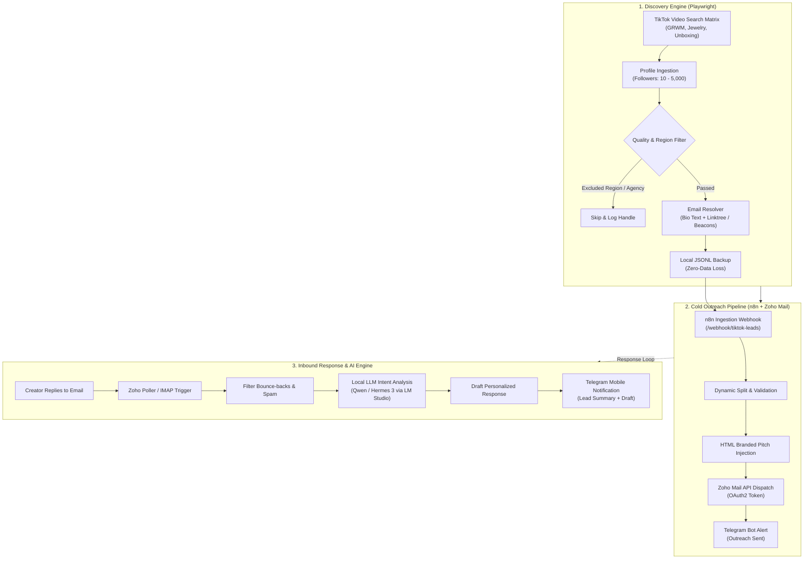

<div align="center">

# ⚡ Creator Outreach Matrix
### *Autonomous TikTok Creator Discovery & AI-Powered Cold Outreach Engine*

[](https://python.org)
[](https://playwright.dev)
[](https://n8n.io)
[](https://www.zoho.com/mail/)
[](https://telegram.org)

<p align="center">
  <b>A zero-friction, end-to-end influencer acquisition pipeline.</b><br>
  Find qualified nano & micro-creators, bypass bot detection, resolve obfuscated emails & bio-links, dispatch branded collaboration emails via Zoho Mail API, analyze inbound replies with local LLMs, and receive instant Telegram alerts.
</p>

---

</div>

## 🌟 Key Highlights

- **🎯 Precision Micro-Influencer Targeting**: Scrapes creators in targeted follower brackets (10 – 5,000 followers) using hydration script parsing (`__UNIVERSAL_DATA_FOR_REHYDRATION__` & `SIGI_STATE`) with DOM query fallbacks to prevent zero-follower extraction bugs.
- **🛡️ Bot-Evasion & Route Blocking**: Runs persistent Chrome contexts with disabled automation flags (`--disable-blink-features=AutomationControlled`), test banner suppression, dynamic sleep jitter, and instant media route abortion (drops images/video streams for 3x–5x speed boost and minimal CPU/RAM).
- **🔍 Deep Email Intelligence**: Detects obfuscated emails (`name (at) domain (dot) com`) and crawls external bio-links (Linktree, Beacons, custom personal portfolios) to uncover hidden business emails.
- **🚫 Automated Quality & Region Filtering**: Skips commercial shops, talent agencies, UGC creators, salon booking pages, and non-shipping/sanctioned destinations.
- **⚡ Fully Automated Outreach (n8n)**: Instant webhook ingestion pushes verified leads to Zoho Mail API for automated personalized cold outreach.
- **🧠 Local AI Intent Parsing**: Listens for inbound replies, extracts intent using a local LLM (LM Studio / Ollama / OpenAI API format), drafts a smart response, and alerts your phone via Telegram.
- **💾 Fail-Safe Data Backups**: All qualified leads are duplicated locally to JSONL before network requests, ensuring zero data loss if webhooks drop.

---

## 🏛️ System Architecture



---

## 📁 Repository Blueprint

```text
├── live_tiktok_scraper.py                 # High-performance, evasive Playwright scraper
├── scrape_tiktok.py                       # Test dispatcher with mock payloads for testing n8n
├── workflows/                             # Production-ready n8n workflow blueprints
│   ├── Tiktok.json                        # Ingestion Webhook -> HTML Pitch -> Zoho Mail -> Telegram
│   ├── Zoho.json                          # Poller -> LM Studio AI Intent Analysis -> Telegram
│   └── Message.json                       # Real-time IMAP Trigger -> Spam Filter -> Telegram
├── templates/                             # Battle-tested outreach email copies
│   ├── initial_outreach_pitch.html        # Clean, responsive HTML brand collaboration pitch
│   ├── collaboration_onboarding.txt      # Step-by-step catalog voucher & onboarding instructions
│   └── shipping_and_commission_faq.txt    # Transparent FAQ addressing logistics & $25 payouts
├── requirements.txt                       # Minimal dependencies (playwright, requests)
├── .env.example                           # Sample configuration variables
└── .gitignore                             # Prevents tracking browser sessions, cookies, & leads
```

---

## 🚀 Quickstart Guide

### 1. Clone & Set Up Python Environment

```bash
git clone https://github.com/TORBIomar/creator-outreach-matrix.git
cd creator-outreach-matrix

python3 -m venv venv
source venv/bin/activate
pip install -r requirements.txt
playwright install chromium
```

> [!NOTE]
> The scraper utilizes Google Chrome installed on your system for maximum bot evasion. Ensure Chrome is installed, or customize the `channel` flag in `live_tiktok_scraper.py`.

### 2. Configure Environment

Copy `.env.example` to `.env`:

```bash
cp .env.example .env
```

| Variable | Description | Default |
| :--- | :--- | :--- |
| `N8N_WEBHOOK_URL` | Endpoint where scraped leads are dispatched | `http://localhost:5678/webhook/tiktok-leads` |
| `SEEN_FILE` | Local record of previously evaluated creators | `seen_creators.txt` |
| `BACKUP_LEADS_FILE` | Fallback persistence file for qualified leads | `leads_backup.jsonl` |
| `USER_DATA_DIR` | Chrome persistent session cache directory | `browser_profile` |

---

## 🔄 Setting Up n8n Workflows

1. Open your n8n workspace (e.g. `http://localhost:5678`).
2. Go to **Workflows** -> Click **Import from File** (or drag & drop the files from [`workflows/`](file:///home/maro/Desktop/Tiktok-scraper-git/workflows/)):
   - **`Tiktok.json`**: Connect your **Zoho Mail OAuth2** account, enter your Zoho Account ID, and provide your Telegram Bot Token & Chat ID.
   - **`Zoho.json`**: Connects to Zoho Mail API to read incoming emails, routes them through a local LLM (e.g., LM Studio at `http://localhost:1234/v1/chat/completions`), and pings Telegram with the classification.
   - **`Message.json`**: Alternative IMAP inbox watcher for immediate reply alerts.
3. Activate the workflows.

---

## 🏃 Running the Engine

### Step 1: Validate Your Setup
Send a batch of mock leads into n8n to test your Zoho Mail connection and Telegram bot:
```bash
python scrape_tiktok.py
```

### Step 2: Launch Autonomous Discovery
Start the live scraper:
```bash
python live_tiktok_scraper.py
```

* **Human Emulation**: Scrolls video search results, clicks profiles with randomized delays, and paces outreach in batches of 50.
* **Graceful Exit**: Press `Ctrl+C` at any time. The scraper completes the active profile, preserves the `seen_creators.txt` index, and shuts down cleanly.

---

## 📧 Email Templates Included

Battle-tested templates are located in [`templates/`](file:///home/maro/Desktop/Tiktok-scraper-git/templates/):
* **Initial Outreach**: High-converting HTML pitch highlighting gifting terms and affiliate upside.
* **Onboarding Steps**: Step-by-step instructions on exploring collections and applying voucher codes.
* **FAQ Reply**: Transparent handling of international logistics, weight-based shipping, and commission payouts.

---

## 🛡️ Privacy & Security Best Practices

* **No Credentials in Git**: All tokens, API keys, chat IDs, and brand information have been completely scrubbed from this repository.
* **Git-Protected Data**: Browser profiles (cookies/sessions) and collected lead data are strictly ignored via `.gitignore` to protect privacy and stay compliant.

---

<div align="center">
  <sub>Built with precision for creators, brands, and growth engineers.</sub>
</div>
