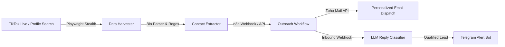

# ⚡ Creator Outreach Matrix
### *Autonomous TikTok Creator Discovery & AI-Powered Cold Outreach Engine*

<div align="center">

[](https://python.org)
[](https://playwright.dev)
[](https://n8n.io)
[](https://www.zoho.com/mail/)
[](https://telegram.org)

<p align="center">
  <b>A zero-friction, end-to-end influencer acquisition pipeline.</b><br>
  Find qualified nano & micro-creators, bypass bot detection, resolve obfuscated emails & bio-links, dispatch branded collaboration emails via Zoho Mail API, analyze inbound replies with local LLMs, and receive instant Telegram alerts.
</p>

</div>

---

## ✨ Features & Architecture



- **🕵️ Anti-Fingerprint Scraping**: Evasive Playwright automation bypassing TikTok captcha heuristics and rate limits.
- **💾 Persistent SeenStore**: Low-overhead deduplication store keeping tracked creators in memory with instant disk persistence.
- **Durable v2 queue**: SQLite profile queue, email cache, retry scheduling and delivery outbox resume after restarts.
- **Nano creator discovery**: Searches target small accounts and adapt to the fraction of profiles within the configured follower range.
- **Dry-run controls**: Hold leads locally with `--dry-run`; deliver held leads only with `--release-held`.
- **🛡️ Fault-Tolerant Backup**: Automatic local jsonl backup preserves captured leads if webhook endpoints become unavailable.
- **✉️ Automated Outreach**: Dynamic cold-pitch dispatching configured with Zoho OAuth2 API.
- **🧠 AI Intent Analysis**: Automatic classification of inbound replies (Interested, Price Quote, Decline) using LLMs.
- **📱 Real-Time Notifications**: Instant mobile push alerts on Telegram when creators accept collaboration terms.

---

## 🛠️ Quickstart

```bash
# Clone repository
git clone https://github.com/TORBIomar/creator-outreach-matrix.git
cd creator-outreach-matrix

# Create an environment and install dependencies (Linux/macOS for v2)
python3 -m venv .venv
source .venv/bin/activate
pip install -r requirements.txt
playwright install chromium

# Copy and configure environment variables
cp .env.example .env
# Edit .env and set N8N_WEBHOOK_URL to your configured n8n webhook.

# Run unit tests
python3 -m unittest discover -s tests -p '*_test.py' -v

# Collect locally first; no webhook delivery
python3 live_tiktok_scraper_v2.py --dry-run

# Send newly collected leads to the configured webhook
python3 live_tiktok_scraper_v2.py
```

The current version is `live_tiktok_scraper_v2.py`. See [v2 usage](README_v2.md)
for saved state, retries, held leads, tuning and migration from existing backups.
The original `live_tiktok_scraper.py` remains available for existing setups.
Offline tests use temporary databases and mocked network calls. Live browser and
n8n delivery behavior must be checked in your own environment.

## n8n setup

Import `workflows/Tiktok.json`, `workflows/Zoho.json` and `workflows/Message.json`
into n8n as needed. The exports are inactive and contain no saved credentials,
pinned data, production webhook identifiers or instance metadata.

1. Reconnect Zoho OAuth2 on the authenticated HTTP Request nodes, Telegram on
   notification nodes, and IMAP on the email trigger.
2. Replace `YOUR_ZOHO_ACCOUNT_ID`, `YOUR_TELEGRAM_CHAT_ID` and
   `sender@example.com` in the imported nodes with your own account values.
3. Customize `[Your Brand]`, the outreach subject, message copy and example links.
   The HTML template is also embedded in the TikTok workflow's Code node.
4. Set the local LLM endpoint/model in the Zoho workflow if you use reply analysis.
   `localhost` refers to the n8n host or container.
5. Enable the configured workflows and set `N8N_WEBHOOK_URL` in your local `.env`
   to the production URL of the TikTok workflow's `tiktok-leads` webhook.

The scraper retries failed deliveries with a stable `Idempotency-Key` header.
These workflow templates do not enforce deduplication; configure receiver-side
deduplication if repeated deliveries could send duplicate outreach.

## Private local data

Keep `.env`, scraper state, lead backups, browser profiles and n8n credential
exports local. `.gitignore` excludes these files, including SQLite databases and
v2 state. Only synthetic test data and placeholder configuration belong in this
repository. Previously tracked files still require manual removal even if ignored.

---

## 👨‍💻 Author

**Omar Torbi** — Full-Stack Engineer & Software Architect
- 🌐 **Portfolio**: [omartorbi.engineer](https://www.omartorbi.engineer)
- 💼 **LinkedIn**: [linkedin.com/in/omar-torbi](https://www.linkedin.com/in/omar-torbi-b8340933a/)
- 🐙 **GitHub**: [@TORBIomar](https://github.com/TORBIomar)
