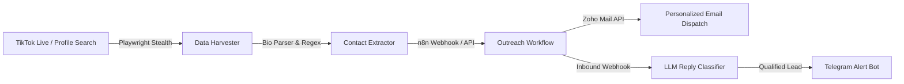

# ⚡ Creator Outreach Matrix
### *Autonomous TikTok Creator Discovery & AI-Powered Cold Outreach Engine*

<div align="center">

[](https://python.org)
[](https://playwright.dev)
[](https://n8n.io)
[](https://www.zoho.com/mail/)
[](https://telegram.org)

<p align="center">
  <b>A zero-friction, end-to-end influencer acquisition pipeline.</b><br>
  Find qualified nano & micro-creators, bypass bot detection, resolve obfuscated emails & bio-links, dispatch branded collaboration emails via Zoho Mail API, analyze inbound replies with local LLMs, and receive instant Telegram alerts.
</p>

</div>

---

## ✨ Features & Architecture



- **🕵️ Anti-Fingerprint Scraping**: Evasive Playwright automation bypassing TikTok captcha heuristics and rate limits.
- **💾 Persistent SeenStore**: Low-overhead deduplication store keeping tracked creators in memory with instant disk persistence.
- **🛡️ Fault-Tolerant Backup**: Automatic local jsonl backup preserves captured leads if webhook endpoints become unavailable.
- **✉️ Automated Outreach**: Dynamic cold-pitch dispatching configured with Zoho OAuth2 API.
- **🧠 AI Intent Analysis**: Automatic classification of inbound replies (Interested, Price Quote, Decline) using LLMs.
- **📱 Real-Time Notifications**: Instant mobile push alerts on Telegram when creators accept collaboration terms.

---

## 🛠️ Quickstart

```bash
# Clone repository
git clone https://github.com/TORBIomar/creator-outreach-matrix.git
cd creator-outreach-matrix

# Install dependencies
pip install -r requirements.txt
playwright install chromium

# Copy and configure environment variables
cp .env.example .env

# Run unit tests
python3 -m unittest discover -s tests -p '*_test.py' -v

# Run scraper
python live_tiktok_scraper.py
```

---

## 👨‍💻 Author

**Omar Torbi** — Full-Stack Engineer & Software Architect
- 🌐 **Portfolio**: [omartorbi.engineer](https://www.omartorbi.engineer)
- 💼 **LinkedIn**: [linkedin.com/in/omar-torbi](https://www.linkedin.com/in/omar-torbi-b8340933a/)
- 🐙 **GitHub**: [@TORBIomar](https://github.com/TORBIomar)
- ✉️ **Email**: [torbi.dev@outlook.com](mailto:torbi.dev@outlook.com)
